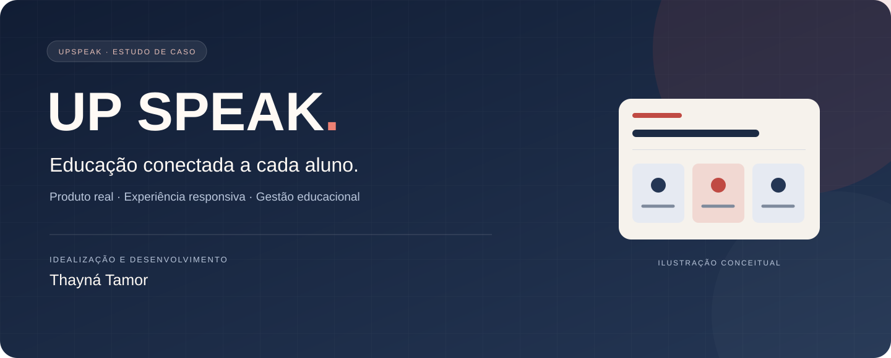

<!-- Este README é público. Não incluir credenciais, configurações de contas ou dados de estudantes. -->

<strong>Plataforma de ensino de inglês · Estudo de caso de produto e tecnologia</strong>

<a href="https://upspeak.isadoraamorim.workers.dev">Conheça o site</a> · <a href="docs/estudo-de-caso.md">Estudo de caso</a> · <a href="docs/arquitetura.md">Arquitetura</a> · <a href="docs/visao-de-dados.md">Visão de dados</a> · <a href="docs/jornadas.md">Jornadas de uso</a>

# Um projeto que nasceu de uma necessidade real

Criei a **UpSpeak** para apoiar o trabalho da minha esposa, a professora **Isadora Amorim**, e organizar em uma mesma plataforma a apresentação do curso e a experiência de ensino e aprendizagem.

O projeto conecta o trabalho da professora às necessidades de estudantes de inglês, com atendimento em **turmas e aulas particulares**, materiais personalizados e acompanhamento pedagógico.

| Autoria do projeto | Responsabilidade pedagógica | Formato deste repositório |
| :--- | :--- | :--- |
| **Thayná Tamor** — idealização e desenvolvimento | **Isadora Amorim** — professora | Documentação pública de portfólio |

## Explore o projeto

| Quero conhecer… | Onde encontrar |
| :--- | :--- |
| O contexto, a solução e os aprendizados | [Estudo de caso](docs/estudo-de-caso.md) |
| As tecnologias e suas responsabilidades | [Arquitetura comentada](docs/arquitetura.md) |
| A experiência de professora e aluno | [Jornadas do produto](docs/jornadas.md) |
| A organização conceitual das informações | [Visão de dados](docs/visao-de-dados.md) |
| O escopo e os cuidados de apresentação | [Qualidade e limites](docs/qualidade-e-limites.md) |
| Os créditos e as condições de uso | [Autoria e uso](NOTICE.md) |

## Da necessidade à experiência

| Necessidade | Resposta no produto | Por que isso importa |
| :--- | :--- | :--- |
| Apresentar o curso e a professora | Site institucional e avaliações públicas | Reúne informações para quem está conhecendo a escola |
| Organizar diferentes atendimentos | Alunos, turmas e aulas particulares | Acomoda formatos distintos de ensino |
| Centralizar o conteúdo | Materiais, atividades e avaliações | Aproxima o conteúdo da rotina de estudo |
| Receber e acompanhar entregas | Respostas, anexos e correções | Conecta a prática do aluno ao retorno da professora |
| Registrar a evolução | Boletins e documentos PDF | Organiza o acompanhamento pedagógico |
| Incentivar a prática | English Lab | Disponibiliza exercícios complementares |
| Acessar por diferentes dispositivos | Interface responsiva | Considera o uso em computador, celular e tablet |

## Construção técnica

**React · Tailwind CSS · Vinext · Vite · Supabase · PostgreSQL · Cloudflare Workers · D1 · pdf-lib**

A interface utiliza React e Tailwind CSS. O portal integra autenticação, dados e arquivos com Supabase; a aplicação é preparada para Cloudflare Workers. As avaliações públicas do site utilizam D1 e são diferentes das avaliações pedagógicas.

A [documentação de arquitetura](docs/arquitetura.md) explica essa divisão sem expor a configuração operacional.

## Meu papel e os aprendizados

Trabalhei no entendimento das necessidades da professora, na organização das funcionalidades, no desenvolvimento da interface e nas integrações necessárias para persistência e publicação.

O projeto trouxe prática em **requisitos de negócio, organização de dados, autenticação, experiência do usuário e evolução a partir de feedback**.

### Organização das informações

A plataforma reúne informações de **alunos, turmas, atividades, entregas, correções e boletins**. Organizar essas relações ajuda a preservar o contexto de cada registro: quem enviou uma resposta, a qual atividade ela pertence e a qual estudante e período um boletim se refere.

A [visão de dados](docs/visao-de-dados.md) apresenta esses conceitos e as relações do domínio, sem expor registros de estudantes ou a configuração do banco.

### Relação com meu foco em Análise de Dados

A UpSpeak também contribuiu para meu interesse pela área de dados. Ao desenvolver a plataforma, trabalhei com a organização de informações de alunos, turmas, atividades e avaliações e com as relações entre esses registros. Essa experiência faz parte da base que estou aprofundando nos meus estudos em Análise de Dados.

O trabalho apresentado aqui é de **desenvolvimento web e organização de informações**. As perguntas analíticas descritas na visão de dados são possibilidades de evolução; este estudo de caso não apresenta dashboards ou resultados quantitativos de uso.

## Visitação e demonstração

O [site público da UpSpeak](https://upspeak.isadoraamorim.workers.dev) apresenta o curso. O portal é destinado aos usuários autorizados da escola.

Este repositório contém documentação e recursos visuais de apresentação. O código completo é mantido privado. A capa é uma ilustração conceitual, não uma captura do portal.

Para demonstrar fluxos internos, utilize uma apresentação acompanhada e dados fictícios. Não há credenciais de acesso ou registros de estudantes neste repositório.

---

<strong>Idealização e desenvolvimento por Thayná Tamor</strong> Projeto criado para o trabalho pedagógico de Isadora Amorim. © 2026 · <a href="NOTICE.md">Autoria e uso</a>

