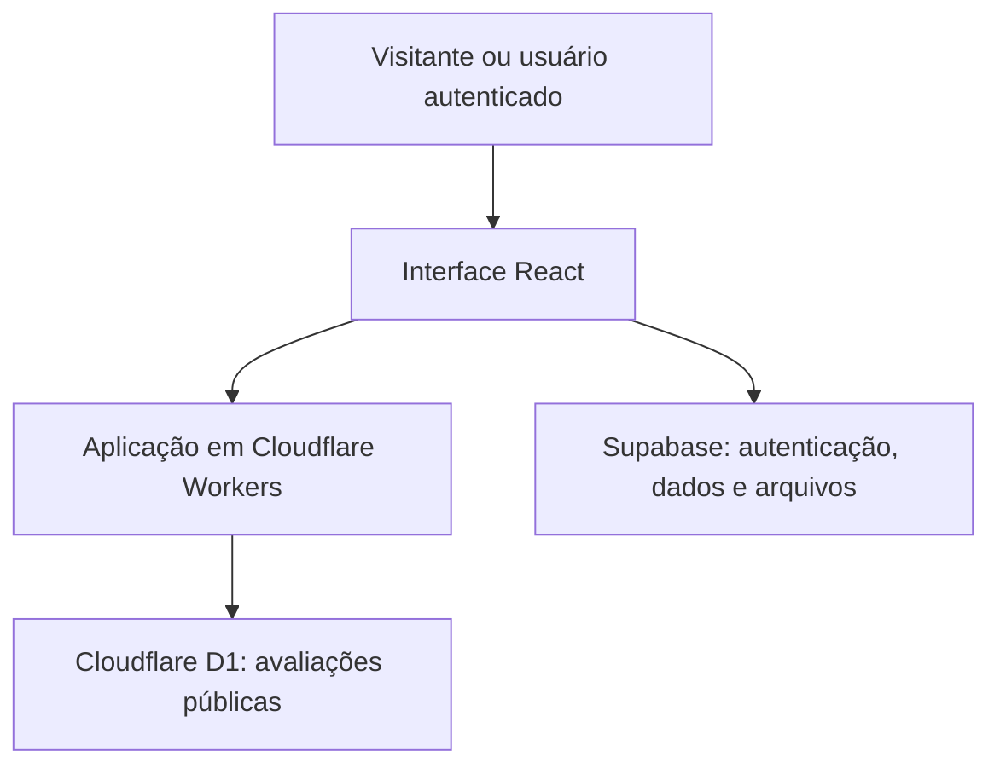

# Arquitetura conceitual

[← Voltar à apresentação](../README.md)

O diagrama apresenta as responsabilidades gerais; não detalha endpoints, políticas de acesso ou configurações internas.

## Responsabilidades

| Componente | Papel |
| --- | --- |
| React e Tailwind CSS | Apresentação, formulários e interação |
| Vinext e Vite | Estrutura e construção da aplicação |
| Cloudflare Workers | Execução e entrega da aplicação |
| Supabase | Identidade, informações pedagógicas e anexos |
| Cloudflare D1 | Persistência das avaliações públicas da escola |
| pdf-lib | Construção de documentos PDF |

## Organização do domínio

O portal relaciona alunos, turmas ou atendimentos particulares, materiais, atividades, avaliações, entregas, correções e boletins. O detalhamento do esquema e das regras de acesso permanece no projeto privado.

O acesso de professora e aluno precisa ser aplicado também no backend e nas políticas de banco; ocultar um botão na interface não substitui autorização.

## Publicação deste estudo de caso

Esta documentação não requer instalação, banco ou variáveis de ambiente. A aplicação completa possui configuração própria, mantida fora deste repositório público.
